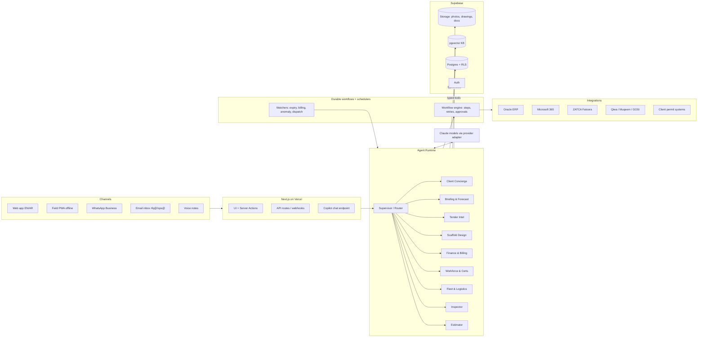

# RGS OneSite — Agentic AI Platform Architecture

**Client:** Resa Gulf Scaffolding Co. Ltd. (RGS), Tamimi Holdings, Khobar, KSA
**Status:** v0.1 blueprint for the 1‑week MVP
**Working name:** "RGS OneSite" (placeholder, can be renamed)

---

## 1. Goals

One bilingual (English / Arabic RTL) platform where **RGS staff** and **RGS clients** run the
scaffolding business end to end, with AI agents doing the routine work:

1. **Requests, quotes and tenders:** RFQ or drawings in, priced proposal out.
2. **Inspections and tag compliance:** scaffold register, green/yellow/red tags, 7‑day re‑inspection, photo defect detection.
3. **Rental fleet and logistics:** yard stock, on‑hire per site, deliveries and pickups, overdue returns, billing.
4. **Manpower, training and certifications:** crew allocation, competency matrix, iqama and cert expiries.

Design principles:

- **Agents act through typed tools only.** They never write raw SQL or call free-form HTTP.
- **Tiered autonomy.** Low risk runs automatically. Money, safety or client-facing actions need human approval.
- **Everything is auditable.** Every agent run, tool call, approval and data change is traced.
- **Offline first in the field.** Offshore platforms and plants have poor signal.
- **KSA ready.** It can move to a Saudi cloud region without a rewrite.

---

## 2. Users and roles

| Role | Side | Key capabilities |
|---|---|---|
| Admin | RGS | Users, rate cards, policies, integrations |
| Operations Manager | RGS | All sites, approvals, dispatch, KPIs |
| Estimator / Tendering | RGS | Requests, take‑offs, quotes, tenders |
| Site Supervisor | RGS | Jobs, daily logs, crew, change requests |
| Scaffold Inspector | RGS | Inspections, tagging, defect reports (mobile, offline) |
| Yard / Logistics | RGS | Stock, deliveries, pickups, transfers |
| HSE & Training | RGS | Incidents, training, certifications, compliance packs |
| Finance | RGS | On‑hire billing, invoices, ZATCA, credit notes |
| Client Admin / Client User | Client | Own company's sites only: requests, quotes, tag status, off‑hire, documents, invoices |

Multi‑tenancy: `organization` = RGS (the operator). `client_company` rows scope client users.
**Postgres row level security** ensures client users only ever see rows for their `client_company_id`.

---

## 3. System overview



---

## 4. Agent roster

Each agent is a Claude tool‑use loop with a **narrow toolset**, a bilingual system prompt, and memory scopes.
The **Supervisor** classifies intent (EN/AR), picks one or more specialists, and merges the results.

| Agent | Main jobs | Example tools | Autonomy |
|---|---|---|---|
| **Supervisor** | Routing, multi‑step plans, handoffs | `route_to_agent`, `create_task`, `search_kb` | Auto |
| **Estimator** | Read RFQ, BOQ and drawings; extract scope; material take‑off; price from the rate card; draft quote EN/AR | `extract_scope_from_doc`, `compute_takeoff`, `price_quote`, `draft_quote_pdf` | Draft auto. **Send needs approval** |
| **Inspector** | Inspection checklists, photo defect detection, tag status, re‑inspection schedule, HSE report | `analyze_scaffold_photo`, `record_inspection`, `propose_tag_status`, `schedule_reinspection` | Green or yellow proposal auto. **Clearing a red tag needs a competent‑person sign‑off** |
| **Fleet & Logistics** | Yard stock, on‑hire, transfers, delivery notes OCR, dispatch routes and truck loads | `get_stock`, `reserve_items`, `ocr_delivery_note`, `plan_dispatch` | Plan auto. **Dispatch confirmation needs approval** |
| **Workforce & Certs** | Crew allocation, competency matrix, cert, ID and iqama reading, expiry alerts | `read_certificate`, `match_crew_to_job`, `list_expiring` | Alerts auto. **Allocation changes need approval** |
| **Finance & Billing** | Unbilled on‑hire days, invoice drafts, PO matching, ZATCA e‑invoice | `compute_onhire_charges`, `draft_invoice`, `submit_zatca` | **Always approval** |
| **Scaffold Design** | Configuration, load class, standards check (Aramco GI, OSHA, EN 12811, BS 5975), design notes | `select_configuration`, `check_load_class`, `cite_standard` | **Advisory only, engineer sign‑off** |
| **Tender Intelligence** | Win/loss analysis, price suggestion, win probability, tender response drafts | `similar_past_tenders`, `margin_analysis` | Advisory |
| **Briefing & Forecast** | Daily/weekly EN/AR executive brief, demand forecast (material, manpower, turnaround season) | `kpi_snapshot`, `forecast_demand`, `risk_scan` | Auto (read only) |
| **Client Concierge** | Client‑side chat and WhatsApp: requests, instant indicative quote, site status Q&A, off‑hire, compliance packs | client‑scoped versions of the tools above | Indicative auto. **Booking needs confirmation** |

### 4.1 Autonomy policy (tiered by risk)

The policy lives in the DB (`agent_policies`) and is editable by Admin.

| Tier | Examples | Behaviour |
|---|---|---|
| T0 Read | Answer questions, briefs, search | Execute |
| T1 Low‑risk write | Create task, reminder, draft, schedule suggestion | Execute and log |
| T2 Business write | Reserve stock, assign crew, change job dates | Execute only with role permission, otherwise approval |
| T3 Money / safety / external | Send quote, issue invoice, clear red tag, message a client | **Approval required** (in-app, WhatsApp or email approve link) |

Every T2/T3 tool call creates an `approval_request` row. The workflow **pauses** until it is resolved, then resumes.

### 4.2 Background watchers (proactive agents)

These run on a schedule (Vercel Cron / Supabase `pg_cron`, which triggers workflows):

- **Expiry & compliance:** tags due for the 7‑day re‑inspection, certs, iqamas, equipment calibration, insurance. Creates tasks and notifies.
- **Rental & billing:** overdue returns, off‑hire requests not collected, unbilled on‑hire days, missing POs. Drafts invoices for approval.
- **Anomaly & risk:** shrinkage between yard dispatch and site returns, unusual consumption, repeated defects per site, schedule slippage.
- **Auto‑dispatch planner:** next‑day delivery and pickup plan with truck loads across Eastern Province sites. Crew suggestions.

### 4.3 Durable workflows

Long, multi‑step jobs (RFQ to quote, inspection to report, month‑end billing) run as **durable workflows**:
persisted steps, retries, pauses for approval, and resume after a crash. MVP: a Postgres‑backed step runner
(`workflow_runs`, `workflow_steps`) with a worker endpoint. It can move later to Vercel Workflow / Inngest / Temporal behind the same interface.

---

## 5. AI layer

- **Provider adapter** (`lib/ai/provider.ts`): Claude via the Anthropic API **or** Vercel AI Gateway, plus a **mock provider**
  that returns deterministic structured outputs, so the whole app runs and demos with no key (`AI_MODE=mock|live`).
- **Model routing:** the most capable Claude model for estimating, design and vision; a fast model for routing, classification, extraction and chat.
  Automatic fallback model on errors or overload.
- **Structured outputs:** every tool input and output is validated with Zod schemas.
- **Vision and documents:** PDFs, drawings, photos, delivery notes, certificates and IDs go straight to Claude vision/PDF input. Results go into typed records with a confidence score per field.
- **Voice:** a speech‑to‑text adapter (EN/AR/UR/HI) turns voice notes into text, which the agents handle.
- **Arabic:** agents reply in the user's language. Generated documents come in bilingual templates.

### 5.1 Memory and knowledge

| Memory | Store | Use |
|---|---|---|
| Company knowledge base | `kb_documents` + `kb_chunks` (pgvector) | RAG over method statements, HSE procedures, client specs, past quotes, **with citations** |
| Client & site memory | `memories` (scope = client / site) | Rates, access rules, contacts, preferences |
| Learned examples | `agent_examples` | Human corrections to quotes and inspections stored as few‑shot examples |
| Lessons learned | `incidents` linked to `kb_chunks` | Warn on similar future jobs |

### 5.2 Safety and guardrails

- **Prompt‑injection defence:** uploaded docs, emails and WhatsApp text are treated as *data*, wrapped and labelled. They can never call T2/T3 tools directly.
- **PII redaction** in traces (iqama numbers, phones).
- **Tool allowlists** per agent and per role. Client agents only get client‑scoped tools, and RLS applies.
- **Rate and cost limits** per user and org.

### 5.3 Quality: evals, tracing, feedback

- `agent_runs`, `agent_steps`: full trace (prompt version, model, tokens, cost, latency, tool calls).
- Thumbs up/down and correction capture on every agent output.
- Eval suites in `evals/`: quote accuracy against golden take‑offs, defect detection against labelled photos, Arabic response quality, routing accuracy. Run in CI.
- AI Ops dashboard: cost, latency, failure rate, approval rate, override rate per agent.

---

## 6. Data model (core)

```
organizations, client_companies, profiles(role, client_company_id), sites(client_company_id, type: offshore/petrochem/high-rise/marine)
requests(source: web/whatsapp/email, status) → quotes → quote_lines → jobs
rate_cards, rate_items (erection per m³, rental per day/week, mobilisation, offshore uplift)  [SAMPLE values]
scaffolds(site, tag_no, qr, type, load_class, status: green/yellow/red/dismantled, next_inspection_due)
inspections(scaffold, inspector, checklist jsonb, photos, ai_findings jsonb, result) ; defects
items(catalog: tube, coupler, board, ledger, standard, transom, base plate, system components), stock(location, qty)
movements(type: delivery/return/transfer, delivery_note, lines) ; on_hire(site, item, qty, start, end)
dispatch_plans, vehicles
workers(iqama, expiry, trade), certifications(type: CITB/OPITO/TUV/Aramco, expiry), training_sessions, crew_assignments
invoices, invoice_lines (zatca status), purchase_orders
incidents, documents(storage path, kind), kb_documents, kb_chunks(vector)
agent_runs, agent_steps, approval_requests, agent_policies, memories, agent_examples, notifications, audit_log
workflow_runs, workflow_steps, integrations, channel_messages(whatsapp/email)
```

All tables have `org_id`. Client‑visible tables have `client_company_id`, enforced by RLS.

---

## 7. Integrations (adapter pattern)

Every integration implements a small interface and ships with a **CSV/Excel adapter first**:

| System | MVP | Production |
|---|---|---|
| Oracle ERP (Fusion / EBS / NetSuite) | CSV import of customers, items, invoices, POs | Oracle REST APIs, two‑way sync |
| Microsoft 365 | Outbound email via SMTP | Graph API: Outlook inbox agent, calendar, Teams notifications, SharePoint docs |
| ZATCA Fatoora | Phase‑2 compliant XML generation (sandbox) | Onboarded device, clearance/reporting API |
| Qiwa / Muqeem / GOSI | Excel import | Official APIs where RGS has access |
| Client permit systems (e.g. Aramco) | Export/email ingestion | API if offered |
| WhatsApp Business | Webhook handler + Cloud API client (needs Meta account) | Same |
| Email inbox | Inbound webhook (forwarded mail) | Graph subscription |

---

## 8. Frontend

- **Next.js (App Router) + TypeScript + Tailwind**, with `next-intl` for EN/AR and full **RTL** layout.
- Separate shells: `/ops` (RGS staff), `/client` (client portal), `/field` (mobile PWA for inspectors and supervisors).
- **PWA:** service worker, IndexedDB outbox for inspections and photos, background sync, QR scanning of tags.
- Copilot side panel on every screen. It knows the current record ("this scaffold", "this quote").
- RGS branding from rgsksa.com.

---

## 9. Security and governance (enterprise baseline)

- Supabase Auth (email/OTP now, **Azure AD SSO‑ready** via SAML/OIDC), optional MFA.
- RBAC in the app, plus **RLS** in Postgres as defence in depth.
- Append‑only `audit_log` for every data change and agent action.
- Secrets only in Vercel/Supabase env, never in code.
- **Data residency:** the MVP runs on the nearest Supabase/Vercel regions with **sample data only**. Production path: a KSA region
  (e.g. Google Cloud Dammam, Oracle Jeddah, STC Cloud) with self‑hosted Postgres/Supabase, plus PDPL and NCA ECC control mapping.
  The AI provider choice gets reviewed for residency at that stage.

---

## 10. Repository layout

The MVP is **one Next.js app**, with agent, AI and workflow code in folders. That's faster to ship in a week; the folders can move into packages later without changing the code.

```
src/app/ops        RGS staff console
src/app/client     Client portal (same queries; RLS scopes the data)
src/app/field      Mobile field app (PWA)
src/lib/db.ts      withUser() sets JWT claims + role per transaction so RLS applies; withSystem() for watchers
src/lib/auth.ts    Demo persona sessions now; Supabase Auth later (same profile ids)
src/lib/agents     Agent definitions, tools, policies, supervisor          (Day 2)
src/lib/ai         Provider adapter: anthropic | gateway | mock            (Day 2)
src/lib/workflows  Durable step runner + watchers                          (Day 2–6)
supabase/migrations  Schema, RLS, audit. Runs on local Postgres and Supabase
db/local           Role shim for plain local Postgres only
scripts            migrate / seed (SAMPLE data)
messages           en.json / ar.json
evals              Agent eval suites                                       (Day 7)
```

Data access: the app connects with a Postgres connection string and, per request, runs `set local role authenticated` plus
`request.jwt.claims`. Every query then goes through the same RLS policies as Supabase's own API, on local Postgres and on Supabase alike.

---

## 11. One‑week MVP plan

| Day | Deliverable |
|---|---|
| 1 | Monorepo, Next.js shell, EN/AR + RTL, branding, auth, roles, DB schema + RLS + sample seed |
| 2 | Agent runtime: provider adapter (mock/live), tool registry, supervisor, traces, approvals inbox, copilot panel |
| 3 | Requests → Estimator (doc extraction, take‑off, rate card, quote PDF EN/AR) + client self‑service quote |
| 4 | Scaffold register, field PWA inspections (offline, photos, QR), Inspector agent, tag compliance watcher |
| 5 | Fleet: stock, on‑hire, movements, delivery note OCR, dispatch planner, billing watcher, invoice drafts |
| 6 | Workforce: workers, certs OCR, competency matrix, expiry watcher; Briefing agent; client portal Q&A + compliance pack |
| 7 | WhatsApp/email webhooks, evals, AI Ops dashboard, deploy to Vercel + Supabase, demo script |

After the MVP: Oracle and M365 live adapters, ZATCA onboarding, the full design assistant, tender ML, the KSA region migration.

---

## 12. Open items for RGS

1. Real rate card and past quotes (MVP uses **SAMPLE** rates).
2. Oracle product and version, plus API access.
3. Microsoft 365 tenant for SSO and the inbox agent.
4. WhatsApp Business account (Meta) and number.
5. Data residency and Aramco contractor requirements for production.
6. Inspection checklist format RGS uses today, and the tagging scheme (green/yellow/red or other).
7. Logo files in vector format and the final product name.
